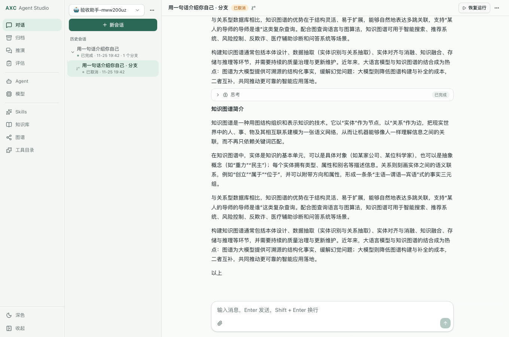
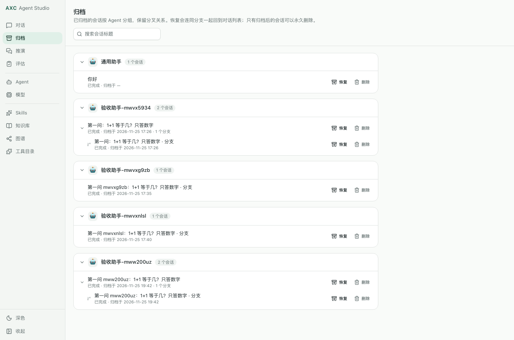
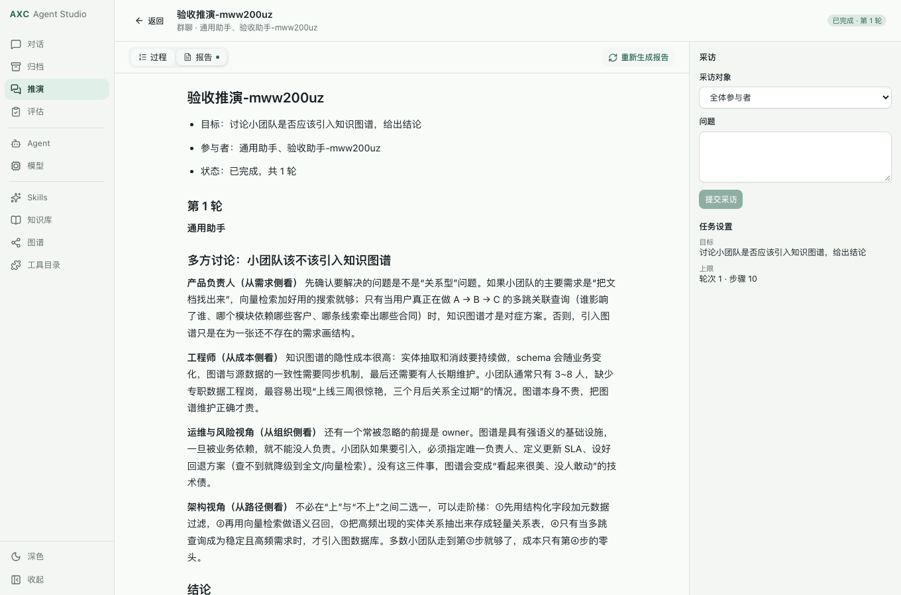
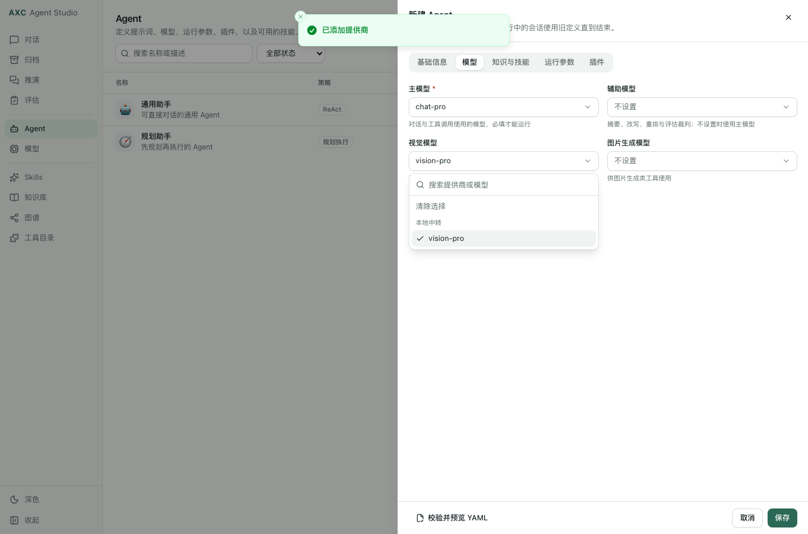
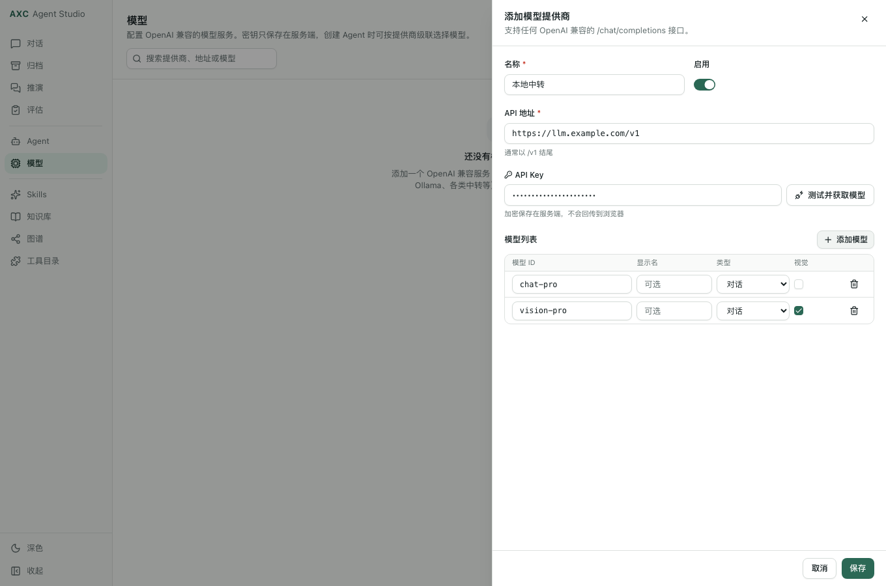
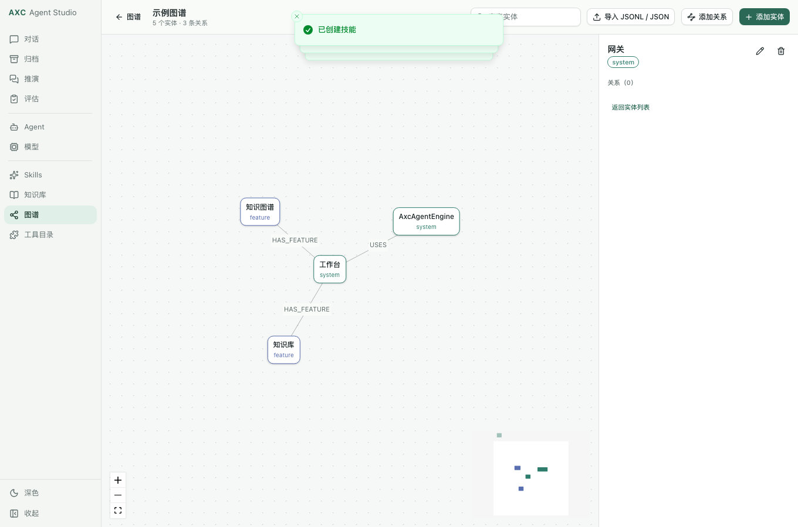

# Axc Agent Studio

基于 [AxcAgentEngine](https://github.com/axclogo/AxcAgentEngine) 的 Agent 工坊：一个可独立运行的应用，同时也是一套可嵌入其他业务页面的 React SDK。

功能：

- **对话**：多轮对话、附件（拖入 / 粘贴 / 选择）、思考与工具调用分段展示、运行中插话 / 排队、停止与恢复、从任意回复开分支（分支树不限深度）、归档。
- **归档**：按 Agent 分组的分叉树，只读预览、恢复（连同分支）、永久删除。会话须先归档才能删除。
- **推演**：十种模式（群聊、主持调度、辩论、红蓝对抗、讨论、访谈、社会模拟、复盘、逆向推演、沙盘），按轮次阅读过程，采访，生成报告。
- **评估**：用例管理，用 Agent 的辅助模型当裁判打分（0–10，6 分及格），人工复核改判，导出 Markdown 报告。
- **人工交互**：开启「人工审批」后，高风险工具调用要你确认，Agent 也能用 ask_human 向你提问，在对话里直接回答。
- **用量与分析**：每条回复显示 token 用量，Agent 列表显示累计；「分析」页用引擎的失败分析、经验蒸馏、成本分析模块生成报告（成本按模型的每千 token 价格估算）。
- **Agent**：提示词、推理策略、三个模型槽位（主 / 辅助 / 视觉，按「提供商 → 模型」级联选择）、运行参数、引擎插件配置（按插件自带的 config_schema 生成表单）、绑定技能 / 知识库 / 图谱 / MCP 服务，YAML 校验与导出。
- **模型**：OpenAI 兼容提供商，API Key 在服务端加密存储，页面只显示掩码；可测试连接并导入远端模型列表。
- **Skills / 知识库 / 图谱 / MCP 服务 / 记忆 / 工具目录**：SKILL.md 编辑与导入；文档上传，可选向量模型做语义检索；实体关系画布与 JSONL 导入；MCP Server（本地命令或 HTTP）管理与连通测试，密钥只写不读；查看和删除 Agent 记下的记忆；引擎插件及配置项一览。

| 对话（分支树、工具调用）                    | 归档                                     | 推演报告                                        |
| ------------------------------------------- | ---------------------------------------- | ----------------------------------------------- |
|           |     |  |
| **Agent 模型级联**                          | **模型提供商**                           | **图谱**                                        |
|  |  |              |

## 目录

```
app/        独立应用入口（工坊、嵌入示例、富文本回归页）
src/        SDK 源码
  core.ts       会话 / 推演协议、快照与事件合并（无 React 依赖）
  client.ts     StudioClient 接口与默认 HTTP 实现
  provider.tsx  StudioProvider：样式作用域、主题、浮层容器、数据缓存
  studio.tsx    AgentStudio：完整工坊（导航 + 各分区）
  workbench.tsx 对话工作台（整页与窄抽屉共用）
  simulation-view.tsx 推演列表 / 表单 / 详情
  studio/       管理分区：agents、providers、skills、knowledge、graphs、mcp、memory、tools、evals、analytics、archive
  ui/           Radix + shadcn 风格基础组件
  styles.css    Tailwind v4 入口（编译后限定在 .axc-root 内）
server/     示例宿主（FastAPI + SQLite），直接使用引擎公开 API
  routers/      HTTP 路由
  services/     业务逻辑：会话与推演、人工交互、运行记录、Agent、提供商、技能、知识库、图谱、MCP、记忆、评估、分析、数据迁移、示例数据
examples/   嵌入示例（专题抽屉、独立推演详情）
tests/      前端（vitest）与服务端（pytest）测试
scripts/    浏览器端到端检查、真实模型验收、打包检查
docs/       协议与架构说明
```

## 启动

需要 Node 22+、Python 3.11+、AxcAgentEngine 3.1.0rc1。Python 依赖统一用 [uv](https://docs.astral.sh/uv/) 安装：

```sh
npm ci
uv venv .venv --python 3.13
uv pip install --python .venv/bin/python -r server/requirements.txt
# 若包索引还没有 3.1.0rc1，先从引擎源码安装：
# uv pip install --python .venv/bin/python '/path/to/AxcAgentEngine[api]'
```

启动服务端与前端（两个终端）：

```sh
AXC_DATA=./data .venv/bin/python -m uvicorn server.app:app --host 127.0.0.1 --port 8765
npm run dev        # http://127.0.0.1:5173 ，嵌入示例 /embed.html
```

首次启动会生成示例 Agent、技能、知识库和图谱（`AXC_SEED=0` 关闭）。在「模型」里添加提供商，在「Agent」里选好主模型即可对话。环境变量见 `server/.env.example`：

- `AXC_MODEL_MODE=openai`（默认）：每个 Agent 使用界面里配置的模型。`fixture`：所有 Agent 用确定性的离线模型，供测试。
- `AXC_SECRET_KEY`：加密 API Key 的 Fernet 密钥；未设置时生成 `$AXC_DATA/secret.key`（权限 0600）。

## 作为 SDK 使用

```tsx
import { AgentStudio, createHttpClient } from '@axc/agent-workbench';
import '@axc/agent-workbench/styles.css';

const client = createHttpClient({ base: '/api', headers: () => ({ Authorization: `Bearer ${token}` }) });

<AgentStudio client={client} theme="light" sections={['chat', 'archive', 'agents', 'models']} />;
```

只嵌入某个界面时包一层 `StudioProvider`：

```tsx
<StudioProvider client={client} Link={BusinessLink}>
  <Workbench
    scope={{ key: 'topic:1', shortcut: { shortcut_key: 'example.topic', context: { topic_id: 1 } } }}
  />
</StudioProvider>
```

- 宿主实现 `StudioClient` 接口即可接入自己的后端，不必走 HTTP；协议见 [docs/API.zh-CN.md](docs/API.zh-CN.md)。
- 样式全部限定在 `.axc-root` 内，不影响宿主页面；在 `.axc-root` 上覆盖 CSS 变量即可换肤（`--primary`、`--background`、`--radius` 等）。
- 组件按自身容器宽度响应，窄抽屉里会把会话列表收成可打开的面板。

## 测试

见 [docs/TESTING.zh-CN.md](docs/TESTING.zh-CN.md)。
